  

  

    
    
    
    
    
  

  <h3>Authorized asset governance · Evidence-driven posture · Accountable remediation</h3>
  
<em>A defensive security operations foundation for teams that need to know what they own, what was observed, what needs attention, and who is responsible.</em>

---

## What SENTINEL is

SENTINEL is an open-source, defensive-security engineering platform for systems that you own or are explicitly authorized to assess. It combines a <strong>FastAPI control API</strong>, a <strong>React security operations console</strong>, SQL persistence, expiry-dated asset authorization, a bounded HTTPS assessment engine, remediation tracking and a tamper-evident audit chain.

The current release is an <strong>engineering baseline</strong>, not a certified enterprise product, compliance platform, WAF, EDR or SIEM. The repository intentionally separates working controls from capabilities that still require infrastructure and independent verification.

| Capability | Implementation |
|:---|:---:|
| Time-bounded authorized asset inventory | Implemented |
| DNS-pinned HTTPS/TLS and extended email/certificate DNS posture | Implemented |
| HSTS/CSP policy-quality analysis | Implemented |
| Explainable risk scoring and findings | Implemented |
| Remediation ownership and task status | Implemented |
| Framework-neutral control mapping | Implemented |
| Redacting inline secret-pattern review | Implemented |
| Hash-linked audit event verification | Implemented |
| Alembic schema migrations | Implemented |
| Overlapping API-key rotation | Implemented |
| Audited CSV exports with formula-injection defense | Implemented |
| PostgreSQL durable assessment queue, idempotency and cancellation | Implemented |
| Separate resource-bounded assessment worker service | Implemented |
| Bounded API request-body enforcement | Implemented |
| RBAC and role-scoped service API credentials | Implemented |
| Shared Redis rate limits per trusted client IP and API credential | Implemented |
| Sensitive-path honeypots and sanitized intrusion evidence | Implemented |
| Hash-linked security event journal and authenticated event API | Implemented |
| Optional HMAC-signed HTTPS security alert webhook | Implemented |
| Trusted-proxy-only source IP attribution | Implemented |
| OIDC/SSO, MFA, human user sessions and multi-tenant isolation | Roadmap |
| Independent network egress gateway and immutable evidence storage | Roadmap |

## Operations console

The browser talks to the API through the console's same-origin `/api/` Nginx reverse proxy; the API service is reached over the private `sentinel-web` Compose network. The console does not need a browser-visible API hostname. The console uses live API-backed information. Asset, finding, remediation and audit views include export actions; the API records each export in the audit journal. It deliberately shows an unauthenticated state instead of presenting fabricated metrics when the control API is not connected.

| Command center | Asset governance |
|:---:|:---:|
| Live assessments, risk snapshot, asset and remediation summary | Owner, environment, criticality, approval reference and expiry-dated scope |

| Findings and remediation | Assurance and audit |
|:---:|:---:|
| Evidence, remediation recommendation and task tracking | Control mapping, event hashes and chain verification |

## Runtime intrusion monitoring

SENTINEL Shield records defensive signals generated by requests reaching SENTINEL's own API:

- Decoy paths such as `/.env`, `/.git/config`, `/.aws/credentials`, `/phpmyadmin`, `/actuator/env` and `/.well-known/sentinel-canary`.
- Failed API-key authentication attempts (HTTP 401) and rate-limit responses (HTTP 429).
- A configurable burst of failed API authentication attempts from the same observed source IP (default: 5 failures in 300 seconds).

Evidence is appended to the existing hash-linked audit journal and can be read using the role-protected `GET /api/v1/security/events` endpoint or the audit view. Each event contains a rule ID, severity, observed IP, URL path without its query string, HTTP method, bounded printable user-agent, timestamp and request ID. Request bodies, query values, cookies and API credential values are not recorded.

**Client IP trust:** SENTINEL accepts `X-Real-IP` only when the immediate TCP peer belongs to `SENTINEL_TRUSTED_PROXY_CIDRS`. The Nginx proxy overwrites this header from its socket peer. SENTINEL deliberately ignores `X-Forwarded-For`; do not expand the trusted CIDR to an untrusted network. The configured trusted CIDR must match the Compose `sentinel-web` subnet.

**Rate limits:** authenticated Redis sliding windows are shared by API instances. Defaults are 120 requests/minute per API credential, 300/minute per observed IP, 10 honeypot events/minute per observed IP, 10 assessments/minute and 20 secret scans/minute. Redis uses a private Compose network and password authentication. Production startup refuses missing/invalid Redis configuration, and requests fail closed with HTTP 503 if the protection store becomes unavailable.

**Alerts:** optionally configure an operator-owned HTTPS webhook. SENTINEL signs the exact JSON request body with HMAC-SHA256 and sends the signature in `X-SENTINEL-Signature`. Configure a secret of at least 32 characters. Verify the signature at the receiving endpoint. Only high/critical events trigger the webhook. Delivery uses a short timeout and does not follow redirects.

An observed IP is a network endpoint, not a verified human identity. VPNs, proxies, NAT and shared networks can obscure the person or device behind it. SENTINEL records evidence from systems you operate; it does not access, compromise or retaliate against an alleged attacker's device or third-party infrastructure.

## Capability map

### 01 — Asset governance

- Register DNS hostnames only inside the configured server-side allowlist.
- Store an asset name, accountable owner, environment, criticality, tags and approval/change reference.
- Require a future, timezone-aware authorization expiry.
- Block managed-asset assessments when the asset is paused, inactive or its authorization has expired.
- Apply asset criticality to the risk model for registered-asset assessments.

### 02 — Bounded web and DNS posture

- Resolve the complete DNS answer set and reject non-global addresses.
- Connect to a literal, previously validated public IP while preserving the original hostname for TLS SNI, certificate verification and the HTTP <code>Host</code> header.
- Send one bounded HTTPS <code>GET /</code>; do not follow redirects or download the response body.
- Enforce a shared timeout budget, bounded DNS answer count and 64 KiB response-header limit.
- Inspect HTTP security-header policy quality, including HSTS lifetime/subdomain scope, CSP unsafe directives, referrer policy and permissive Permissions Policy.
- Inspect MX, SPF duplication and permissive mechanisms, DMARC policy strength, inherited CAA, MTA-STS discovery and SMTP TLS reporting records. DNS checks are passive and do not modify target records; they share a bounded lookup budget and flag incomplete resolver results rather than treating timeouts as missing records.

### 03 — Explainable risk and remediation

- Normalize findings with stable codes, category, severity, confidence, evidence and recommendation.
- Deduplicate <code>(category, code)</code> findings.
- Apply a bounded asset-criticality multiplier and expose the scoring model, weighted points and top risk drivers.
- Create a remediation task only from a finding that exists in a stored assessment.
- Track owner, due date, notes and task state: <code>open</code>, <code>in_progress</code>, <code>resolved</code> or <code>accepted</code>.

> SENTINEL's risk score is its own deterministic prioritization model. It is not a CVSS score and must not be represented as one.

### 04 — Secret hygiene and audit assurance

- Review a submitted text snippet of up to 256 KiB for selected GitHub, AWS, Slack and private-key patterns.
- Return a redacted marker and a short SHA-256 fingerprint; never echo the matched value.
- Do not persist the submitted source text. The audit event records only input byte count and finding count.
- Hash-link audit events with SHA-256 and verify previous-hash continuity and event contents.
- Export bounded assets, assessments, findings, remediations and audit events to authenticated CSV; every export is recorded in the audit journal.
- Neutralize spreadsheet formula-like values in exported cells.
- Report pre-existing unsealed audit records separately.

> Hash chaining is <strong>tamper-evident, not immutable</strong>. A privileged database operator who can rewrite the entire chain can defeat this control. Export signed checkpoints to independently controlled storage for stronger assurance.

### 05 — Operational control mapping

SENTINEL includes a small framework-neutral control catalog that links observations to asset governance, web security, email-domain protection, TLS lifecycle and credential hygiene themes.

<code>not_observed</code> means no matching finding was present in the retained assessments. It does <strong>not</strong> mean a control passed, was tested completely or satisfies a regulatory requirement. This catalog is not a compliance certification or audit opinion.

---

## System architecture

~~~mermaid
flowchart LR
    OP[Security operator] --> UI[React operations console]
    UI -->|API key in memory| API[FastAPI control API]
    API --> AUTH[API authentication]
    AUTH --> INV[Asset registry and authorization expiry]
    AUTH --> SCOPE[Hostname allowlist and scope policy]
    INV --> SCOPE
    SCOPE --> DNS[DNS answer validation]
    DNS --> PIN[DNS-pinned HTTPS probe]
    PIN --> WEB[Authorized HTTPS asset]
    PIN --> EVIDENCE[Header and TLS evidence]
    DNS --> POSTURE[MX / SPF / DMARC posture]
    EVIDENCE --> FIND[Finding normalization]
    POSTURE --> FIND
    FIND --> RISK[Explainable risk engine]
    RISK --> DB[(PostgreSQL / SQLite)]
    API --> REM[Remediation workflow]
    API --> LIMIT[Redis sliding-window rate limits]
    API --> MONITOR[Honeypot and request-signal monitor]
    MONITOR --> AUDIT[Hash-linked audit journal]
    MONITOR --> ALERT[Optional signed HTTPS webhook]
    API --> SECRET[Redacting secret-pattern scan]
    REM --> DB
    AUDIT --> DB
    SECRET --> DB
~~~

### Trust boundaries

| Boundary | Primary controls |
|:---|:---|
| Browser → API | API-key header, explicit CORS allowlist, key held in component memory |
| API → DNS | Hostname normalization, exact/proper-subdomain scope matching, reject non-global answers |
| API → target | Validated-IP connection, hostname-bound TLS, no redirects, bounded header read |
| API → database | SQLAlchemy parameterization, transaction boundaries, assessment retention cap |
| Audit → operator | Hash-chain verification, explicit legacy-unsealed count, assurance limitation |
| Proxy → API | Fixed internal proxy subnet; accept overwritten `X-Real-IP` only from the trusted CIDR |
| API → Redis | Authenticated Redis on the private data network; fail closed on store errors |
| Security alert → webhook | HTTPS only, HMAC-SHA256 body signature, bounded timeout and no redirect following |

<strong>Defence in depth still required:</strong> application-level DNS pinning does not replace a production egress firewall/proxy. Production workers should have network-level destination enforcement.

## API surface

All <code>/api/v1/*</code> routes require <code>X-API-Key</code> and are protected by route-level role authorization. See [API access control](docs/access-control.md) for the role matrix and credential lifecycle.

| Method | Endpoint | Purpose |
|:---:|:---|:---|
| <code>GET</code> | <code>/healthz</code> | Liveness |
| <code>GET</code> | <code>/readyz</code> | Database and migration readiness |
| <code>GET</code> | <code>/api/v1/config</code> | Configured scope and feature policy |
| <code>GET</code> | <code>/api/v1/me</code> | Current service credential identity, role and permissions |
| <code>GET</code>, <code>POST</code> | <code>/api/v1/credentials</code> | Admin-only managed API credential metadata and one-time key creation |
| <code>POST</code> | <code>/api/v1/credentials/{credential_id}/revoke</code> | Admin-only immediate credential revocation |
| <code>GET</code> | <code>/api/v1/overview</code> | Operational summary |
| <code>GET</code>, <code>POST</code> | <code>/api/v1/assets</code> | List and register authorized assets |
| <code>PATCH</code> | <code>/api/v1/assets/{asset_id}</code> | Update asset metadata/authorization |
| <code>POST</code> | <code>/api/v1/assets/{asset_id}/assessments</code> | Synchronous compatibility route for a registered, currently authorized asset |
| <code>POST</code> | <code>/api/v1/assessment-jobs</code> | Enqueue an idempotent, optionally scheduled registered-asset assessment (HTTP 202) |
| <code>GET</code> | <code>/api/v1/assessment-jobs</code> | List durable jobs with status filter |
| <code>GET</code> | <code>/api/v1/assessment-jobs/{job_id}</code> | Job status, lease and linked result |
| <code>POST</code> | <code>/api/v1/assessment-jobs/{job_id}/cancel</code> | Cancel or request cooperative cancellation |
| <code>POST</code> | <code>/api/v1/assessment-jobs/{job_id}/retry</code> | Manually retry failed/dead-letter jobs after authorization re-check |
| <code>GET</code>, <code>POST</code> | <code>/api/v1/assessments</code> | List or run an ad-hoc in-scope assessment |
| <code>GET</code> | <code>/api/v1/assessments/{assessment_id}</code> | Assessment detail |
| <code>GET</code>, <code>POST</code> | <code>/api/v1/remediations</code> | List or create remediation tasks |
| <code>PATCH</code> | <code>/api/v1/remediations/{task_id}</code> | Update assignee, status, due date or notes |
| <code>GET</code> | <code>/api/v1/controls</code> | Operational finding-to-control mapping |
| <code>POST</code> | <code>/api/v1/secrets/scan</code> | Bounded, non-persisted text secret-pattern review |
| <code>GET</code> | <code>/api/v1/audit</code> | Recent audit events and hashes |
| <code>GET</code> | <code>/api/v1/security/events</code> | Sanitized honeypot, authentication-failure and rate-limit evidence |
| <code>GET</code> | <code>/api/v1/audit/integrity</code> | Verify hash-chain continuity |
| <code>GET</code> | <code>/api/v1/exports/{dataset}.csv</code> | Authenticated, bounded and audited CSV export (`assets`, `assessments`, `findings`, `remediations`, `audit`) |

Queued work is processed by the separate PostgreSQL-backed worker service; the API does not execute queued network assessments in the request process. See [assessment job and worker operations](docs/assessment-jobs.md) for lifecycle, retry, lease and scaling details.

Interactive API documentation is enabled only outside production at <code>/docs</code>.

---

## Quick start

### Requirements

- Docker Engine + Docker Compose plugin, or Python 3.12+ and Node.js 22.12+
- npm 11.12.1 for the checked-in frontend lockfile
- An explicit list of domains that you are authorized to assess
- A strong API key, PostgreSQL password and Redis password

### Docker Compose

1. Clone the repository and create a local environment file:

   ~~~powershell
   Copy-Item .env.example .env
   ~~~

2. Generate separate random hex values for `POSTGRES_PASSWORD`, `REDIS_PASSWORD` and `SENTINEL_API_KEY` (hex avoids URL-reserved characters in the database and Redis URLs):

   ~~~powershell
   python -c "import secrets; print(secrets.token_hex(32))"
   ~~~

3. Set <code>POSTGRES_PASSWORD</code>, <code>REDIS_PASSWORD</code>, a strong bootstrap admin <code>SENTINEL_API_KEY</code> (or <code>SENTINEL_API_KEYS</code> during rotation), <code>SENTINEL_ALLOWED_DOMAINS</code> and <code>SENTINEL_CORS_ORIGINS</code> in <code>.env</code>. Keep <code>SENTINEL_TRUSTED_PROXY_CIDRS</code> aligned with <code>SENTINEL_WEB_SUBNET</code>. Optionally set an operator-controlled <code>SENTINEL_SECURITY_ALERT_WEBHOOK_URL</code> (HTTPS) and a 32+ character <code>SENTINEL_SECURITY_ALERT_WEBHOOK_SECRET</code>. Optional environment-managed service keys use <code>SENTINEL_API_CREDENTIALS_JSON</code>, a JSON array of <code>{id,key,role}</code> records. Prefer creating expiring database-managed credentials through the admin API. Never commit real keys; use a secret manager in production. Production CORS entries must be exact HTTPS origins (no wildcard, credentials, path, query or fragment). The default Compose console is served on <code>http://localhost:8080</code> and calls its API through the same origin, so it does not require an HTTP CORS exception. For a separate cross-origin local development frontend, use a non-production environment and an explicit localhost origin.

4. Start the stack:

   ~~~powershell
   docker compose up --build
   ~~~

5. Open the console at <code>http://localhost:8080</code>. API liveness is <code>http://localhost:8000/healthz</code>; readiness is <code>http://localhost:8000/readyz</code>. Compose also starts one isolated assessment worker after API readiness. Scale the worker independently with <code>docker compose up -d --scale worker=3 worker</code>.

The Compose configuration binds API and console ports to localhost. PostgreSQL is isolated on an internal data network; the API joins a separate outbound network for authorized DNS/HTTPS checks; the static console is isolated on its own internal web network. API and console containers use read-only root filesystems, dropped Linux capabilities, no-new-privileges and non-root identities. PostgreSQL health is checked before API startup; Alembic migrations run before Uvicorn; the console waits for API readiness. The egress network is not a destination-filtering firewall—production requires an independent egress proxy or firewall.

### Local development

<strong>Backend</strong>

~~~powershell
cd backend
python -m venv .venv
.venv\Scripts\Activate.ps1
pip install -r requirements.txt
$env:SENTINEL_ENVIRONMENT = "development"
$env:SENTINEL_API_KEY = "replace-with-a-unique-random-secret-at-least-32-characters"
$env:SENTINEL_ALLOWED_DOMAINS = "example.com"
alembic upgrade head
uvicorn app.main:app --reload
~~~

<strong>Frontend</strong> — in a second terminal:

~~~powershell
cd frontend
npm ci
npm run dev
~~~

The API key is entered into the console and held in component memory; it is not written to local storage.

---

## Engineering validation

The automated GitHub validation suite covers API authentication, role-scoped authorization, managed credential creation/expiry/revocation and overlapping key rotation, trusted-proxy client IP handling, honeypot evidence sanitization, webhook HMAC signatures, Redis sliding-window and fail-closed behavior, scope authorization, time-bounded asset registration, registered-asset assessment, remediation workflows, risk scoring, DNS-pinned transport, audit hash-chain behavior, redacted secret scanning, spreadsheet-safe CSV exports and database migrations.

| Validation | Verification source |
|:---|:---|
| Backend tests (Python 3.12 and 3.13) | Required GitHub Actions CI |
| Ruff lint and format | Required GitHub Actions CI |
| Frontend production build and dependency audit | Required GitHub Actions CI |
| Compose validation, image builds and Trivy scans | Required GitHub Actions CI |
| Redis sliding-window integration test | Required GitHub Actions CI with an isolated Redis service |
| CodeQL, Gitleaks, dependency review and SPDX SBOM | Required GitHub security workflows |

No local execution result is claimed for this change set. Use the exact-head GitHub Actions checks on the pull request as the release gate. Docker runtime, production egress enforcement, sustained production traffic, backup/restore drills and independent penetration testing remain separate deployment verification tasks.

The CI workflow runs Python dependency auditing with pip-audit, npm dependency auditing, backend tests, Ruff checks, frontend production build, authenticated Redis sliding-window integration tests, Docker Compose validation, backend/frontend image builds and HIGH/CRITICAL Trivy scans. Separate GitHub workflows run CodeQL, Gitleaks, dependency review and SPDX SBOM generation. Docker CLI was unavailable locally, so container runtime was not exercised. pip-audit and npm audit both completed successfully; this does not replace image-level or runtime security testing. Docker runtime, production egress enforcement, high-concurrency behavior, restore drills and independent penetration testing are not certified by this release.

---

## What is still required before multi-user industrial deployment?

| Capability | Status | Why it matters |
|:---|:---:|:---|
| OIDC/SSO, MFA and per-human user sessions | Roadmap | Current identities are service credentials, not human user accounts |
| Multi-tenant isolation and row-level policy | Roadmap | Current data model is single-workspace |
| Per-IP and per-credential distributed rate limits | Implemented | Shared Redis sliding windows; per-credential custom quotas remain separate work |
| Per-job disposable sandboxes and stronger worker isolation | Roadmap | Current worker replicas are resource-bounded containers but share the host kernel |
| Network egress gateway / firewall enforcement | Deployment requirement | App-level IP pinning is not a network boundary |
| External append-only audit export/checkpoints | Roadmap | Database administrators can rewrite the stored chain |
| External secret manager integration | Roadmap | Managed credentials are hashed in the application database; production bootstrap and environment keys still need secret-manager custody |
| Metrics, traces, SLO alerting and full observability | Roadmap | Signed security webhooks exist; broader operational telemetry is incomplete |
| Backup/restore and disaster-recovery exercises | Roadmap | No tested RPO/RTO claim |
| Independent penetration test | Not performed | External security assurance is still required |

See [system architecture](docs/blueprint/system-architecture.md), [security algorithms](docs/blueprint/security-algorithms.md), [threat model](docs/blueprint/threat-model.md), [security operations hardening](docs/SECURITY-OPERATIONS.md) and [roadmap](docs/blueprint/roadmap.md) for the target architecture and delivery gates.

## Repository layout

~~~text
backend/
  app/
    routes/           # authenticated assessment-job API
    services/         # scope, DNS, pinned HTTPS, risk, audit, queue and evidence persistence
    worker.py         # separate durable assessment worker entry point
  alembic/            # versioned database migrations
  tests/              # API, queue lifecycle, worker safety, PostgreSQL race and migration tests
frontend/
  src/                # React operations console and SOC design system
docs/
  assets/             # project banner and visual assets
  blueprint/          # architecture, algorithms, threat model and roadmap
.github/
  workflows/          # CI and CodeQL
~~~

## Security and responsible use

SENTINEL is defensive software. Do not add a hostname or assess a system without written authorization. It does not perform exploitation, brute force, credential attacks, stealth operations or arbitrary IP-range discovery.

See [SECURITY.md](SECURITY.md) for responsible vulnerability reporting. Never put real credentials into public issues, test fixtures or screenshots. Secret scanning only covers a limited set of patterns and is not a substitute for dedicated secret-management controls.

## License

SENTINEL is licensed under the <strong>Apache License, Version 2.0</strong>. See [LICENSE](LICENSE) and [NOTICE](NOTICE). Third-party packages retain their respective upstream licenses.

---

  SENTINEL · Defensive Security Operations · Authorization First

